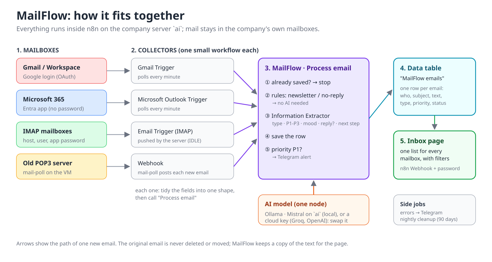

# MailFlow

All company mailboxes in one place, each email sorted for customer service (**type**, **priority**,
**mood**, whether it **needs a reply** and the **next step**), on one web page. Built step by step in **n8n**, with the AI running on the company's own server.

| Start here | What it is |
|---|---|
| [docs/SYSTEM-DESIGN.md](docs/SYSTEM-DESIGN.md) | How it works, the data, the AI (with measured speeds), security, rollout, decisions |
| [docs/WHAT-I-NEED.md](docs/WHAT-I-NEED.md) | Decisions and logins to collect before and during the build |
| [docs/lessons/](docs/lessons/) | Step-by-step lessons for building it yourself in n8n, one working piece per lesson |
| [deck/MailFlow.pdf](deck/MailFlow.pdf) | The presentation (also `deck/MailFlow.pptx` to edit) |

**This repo is public.** It holds the design, lessons, pictures and deck only. Never commit
mailbox addresses, passwords, API keys, email content or workflow exports here; exports go in
the private `n8n-chatbot` repo.
