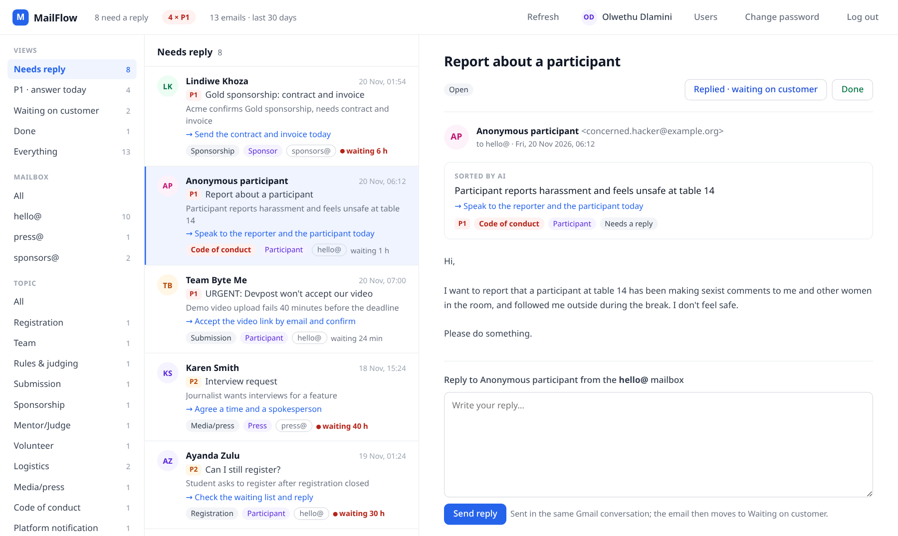
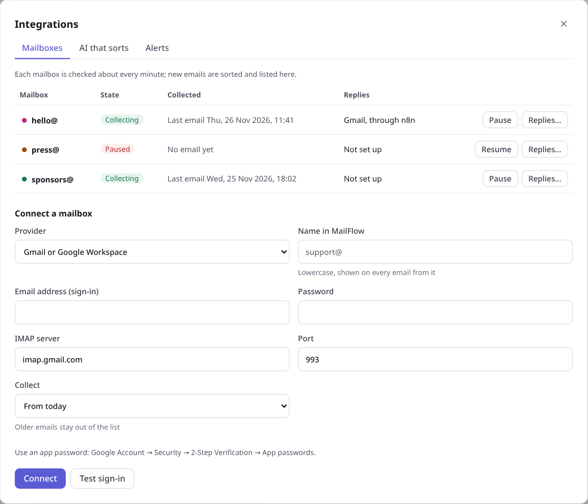

# MailFlow web app

The page staff work in, at `https://mailflow.22112002.xyz`. n8n stays the engine: it collects the
mail, sorts it with the AI and sends Gmail replies. This app shows the `MailFlow emails` data table,
changes an email's status, sends replies (through `MailFlow · Reply` for Gmail, or itself over SMTP),
and lets admins connect mailboxes, choose the AI and set the alerts in n8n from the page.

```
browser ──https──▶ Cloudflare ──tunnel──▶ srv1 Caddy ──▶ ai:3100 MailFlow app ──▶ n8n (API + Reply webhook)
```

| Piece | Where |
|---|---|
| Accounts and sessions | SQLite in the `mailflow_data` volume (`/data/mailflow.db`) |
| Emails | n8n data table, read and updated through n8n's API (key in `.env`, never sent to the browser) |
| Replies | Gmail: `POST http://n8n:5678/webhook/mailflow/reply` with header `X-MailFlow-Secret` (n8n credential `MailFlow app secret`). A mailbox with SMTP set up: sent by the app |
| Integrations | n8n's public API (credentials, workflows); SMTP passwords sealed in SQLite with `MAILFLOW_SECRET_KEY` |

## The page

Signed out, the address shows a short public page: what MailFlow does and how an email flows
through it (collect, sort, work the queue, reply and close), with **Sign in**. Inside the app,
**How MailFlow works** in the account menu (and a small tip in the sidebar until it is closed)
says the same in short, with the keys.



Three panes, after Front, Help Scout and Superhuman: the sidebar (search, views with counts,
mailboxes, refresh state, the account menu; it collapses to icons with `[`), the queue, and the
open email (action bar, AI card, the message, the reply box). Light and dark follow the system.
On a phone the sidebar is a drawer and one pane shows at a time.

| Key | Does | Key | Does |
|---|---|---|---|
| `J` / `K` | next / previous email | `E` | Done |
| `/` | search the list | `W` | replied, waiting on the customer |
| `1`–`6` | Needs reply, Mine, P1, Waiting, Done, Everything | `U` | reopen |
| `Esc` | close the email | `R` | write a reply (`Ctrl`+`Enter` sends) |
| `?` | all shortcuts | `Z` | undo the last status change |
| | | `A` | take the email, or let yours go |

Marking an email Done or Waiting opens the next one in the list, with Undo in the toast.

**Who has it.** Anyone can take an email (Take, or `A`): their name shows on it in the queue and
it is under their **Mine** view. Staff can only take an email nobody has, or let theirs go; an admin
gives any email to anyone, or to nobody. Each email keeps its **activity**: who took it, replied,
marked it or corrected it, and when. Both live in the app's SQLite file (`assignments`, `activity`),
not in n8n, and are pruned 120 days on.

**Correcting the AI.** The priority, topic and needs-a-reply labels on the open email are menus:
a change is written to the n8n table, `sorted_by` becomes `person`, and the email moves to where it
now belongs at once.

## Integrations (admins)

**Integrations** in the account menu, three tabs. Each checks what it can before it changes
anything in n8n, and removes what it made if n8n refuses a later step.



- **Mailboxes.** What collects into MailFlow (any n8n workflow that reads IMAP and runs Process
  email), whether it is on, and when it last collected. Pause and resume any of them; remove those
  the app made. **Connect a mailbox**: Gmail, Outlook/Microsoft 365 or another provider (the server
  is filled in), the sign-in and a password (for Gmail an app password). The app signs in to check,
  then creates the n8n IMAP credential and a collector built like the hand-made ones, from today
  or up to 30 days back, and switches it on.
- **Replies over SMTP**, for any mailbox: server, port, SSL or STARTTLS, sign-in, password, and the
  address and name replies come from. The app signs in to check, then keeps the password sealed
  with `MAILFLOW_SECRET_KEY` (the deploy script makes one). Replies then leave from the app in the
  same conversation (`In-Reply-To`, `References`); the email moves to Waiting. Most providers keep a
  copy in Sent themselves (Gmail, Microsoft 365); others may not.
- **AI that sorts.** The model behind *Sort with AI* in Process email: Mistral on the server
  (Ollama), Groq, OpenAI, Mistral cloud or Anthropic. A new key is checked with the provider first
  (and lists its models); a key already in n8n can be picked. Process email is saved in the app
  (`n8n_backups`) before every change; switch back here at any time. With a cloud provider, each
  email's sender, subject and first 4,000 characters go to that provider.
- **Alerts.** The Telegram chat and bot for P1 emails and errors (Process email and Errors). A new
  bot token sends a test message first.

IMAP passwords, AI keys and bot tokens go straight into n8n credentials, which n8n keeps
encrypted; the app never stores them and n8n never hands them back. The app's n8n API key needs
the workflow and credential scopes (or no scopes) for this page.

## Speed

Every request to the live site crosses Cloudflare, srv1 and ai (about 450 ms there and back), and
a read of the list from n8n takes a second or more. So:

- **The server keeps the 30-day list in memory** (`n8n.py`): read when the app starts, served as is
  for 15 s, then served at once while a fresh copy is read in the background (up to 6 h old; the
  sidebar says *Updating from n8n…* and the page asks again after 2 s). Opening an email and
  status changes use the rows in memory; a change updates them in place.
- **The page arrives with what it needs**: the account, the list and the open email are embedded
  in `GET /` as JSON, so the list shows after one round trip. CSS and JS are stamped with a hash
  of their contents and kept by the browser (and Cloudflare) for a year; a deploy changes the hash.
- **The page does not wait for the server**: an email shows the moment it is picked (the list
  holds all but its text, which follows), the next ones are fetched ahead, status changes and
  Undo apply at once and are saved in the background, the working views are loaded ahead, and
  long lists render 80 rows at a time.

Measured on the laptop with `DEMO_N8N_MS=800 uv run python ../deck/demo_server.py` and a 450 ms
round trip emulated in Chrome (23 Nov 2026):

| Step | Before | After |
|---|---|---|
| Open the page: list shown | 1931 ms | 550 ms |
| Open an email (text follows one round trip later) | 867 ms | 20–50 ms |
| J to the next email | 880 ms | 20–40 ms |
| E: Done, next email open | 2485 ms | 40–80 ms |
| Z: Undo | 3314 ms | 15–40 ms |
| Switch to P1 | 495 ms | 30–50 ms |
| Draw a 3,000-email list | 2.7 s | 74 ms |

Lighthouse (desktop, same 450 ms round trip): sign-in page and queue both 96 performance,
100 accessibility, 100 best practices, 100 SEO (before: 96/91, 95, 96, 90). The rest of the
performance score is the two round trips (page, then CSS) a first visit cannot avoid. The full
reports, before and after: [docs/lighthouse](../docs/lighthouse/README.md).

## Security

- One account per person; an admin adds people under **Users**. Passwords are scrypt-hashed and
  need at least 12 characters.
- **Continue with Google** (optional, below) opens a session only for an account an admin already
  added: never a new account. The first Google sign-in links the account by its verified email,
  but only where Google owns the address (a Gmail address, or one in the Google Workspace domain
  the sign-in names); anyone else signs in with their password. After that Google's account id
  (`sub`) must match, so another Google account with that address cannot take it over. An admin's
  password reset also removes the link. A disabled account is refused either way.
- 5 failed logins on one email lock it for 15 minutes; 20 from one address (an IPv6 /64 counts as
  one) block that address. Each attempt is counted before its password is checked, so attempts sent
  at the same moment cannot get past the limit, and at most 2 passwords are checked at a time (each
  check needs 16 MiB; the container has 128 MB): beyond that the answer is "try again in a moment".
  Behind srv1 the visitor's address comes from Cloudflare's `Cf-Connecting-IP`, believed only on
  requests from `TRUSTED_PROXY`; srv1's Caddy site accepts only the local Cloudflare tunnel, so
  nobody can reach it around Cloudflare and choose that address.
- Sessions: HttpOnly, Secure, SameSite=Strict cookie named `__Host-mf_session` (bound to this exact
  host); signing in again ends the browser's previous session; sessions end after 12 h idle, 7 days,
  logout, a password change or when the user is disabled.
- Every change must carry `X-MailFlow: 1` and come from `SITE_ORIGIN`; strict Content Security
  Policy, no inline script. Email text is always shown as text. Sender-chosen headers are cut to a
  sane length (subject 500, name 200 characters…) and emails dated in the future are kept out of
  the list, so one sender cannot crowd out or overload the queue. A Gmail reply goes out only for a
  well-formed Message-ID.
- Static files are cached for a year only under the current version's address.

## Continue with Google (optional)

Off until both settings are in `.env`. To turn it on:

1. Google Cloud console → **APIs & Services → Credentials → Create credentials → OAuth client ID**,
   type **Web application** (the n8n Gmail client can stay as it is; this is a second client).
2. **Authorised redirect URI**: `https://mailflow.22112002.xyz/auth/google/callback`
   (`SITE_ORIGIN` + `/auth/google/callback`; for the laptop also `http://127.0.0.1:8770/auth/google/callback`).
3. The OAuth consent screen asks only for `openid email profile`. Publish it, or while it is in
   *Testing* add each person as a test user.
4. Put `GOOGLE_CLIENT_ID=…` and `GOOGLE_CLIENT_SECRET=…` in `/opt/mailflow/app/.env` and run the
   deploy script again. The sign-in page then shows the button.

People still need an account: an admin adds them under **Users** with the email address of their
Google account. With Google on, the first password may be left empty: that person can only sign
in with Google (an admin can set a password later).

How it works: `GET /auth/google` stores a one-time state (PKCE verifier and nonce, 10 minutes) and
sends the browser to Google with the state in a SameSite=Lax cookie; `/auth/google/callback`
checks the state against that cookie, swaps the code for the ID token directly with Google, checks
issuer, audience, expiry, nonce and a verified email, and opens the normal session.

## Run on the laptop (against n8n on `ai`)

```bash
cd app
uv sync
export N8N_URL=http://ai:5678 N8N_API_KEY=… MAILFLOW_TABLE_ID=HwHXJgR6FLgD8aeS N8N_REPLY_SECRET=… \
       DB_PATH=/tmp/mailflow.db COOKIE_SECURE=false TRUSTED_PROXY=none SITE_ORIGIN=http://127.0.0.1:8770
uv run mailflow user add --email you@example.com --name You --admin
uv run uvicorn --factory mailflow.web:main_app --port 8770
uv run pytest                     # everything; the browser tests skip without a Chrome
uv run playwright install chromium   # once, for the browser tests (or MAILFLOW_CHROME=/path/to/chrome)
uv run pytest tests/browser       # the page in Chrome against made-up emails (deck/demo_server.py)
```

## Deploy on `ai`

First stage the settings as `~/mailflow.env` on `ai` (mode 600, values as in `.env.example`;
`TRUSTED_PROXY=10.0.0.10`, srv1's LAN address). Then, on `ai`:

```bash
wget -qO /tmp/ai-deploy.sh https://raw.githubusercontent.com/Olwethu-Dlamini/mailflow/main/app/deploy/ai-deploy.sh && sudo bash /tmp/ai-deploy.sh
```

[`deploy/ai-deploy.sh`](deploy/ai-deploy.sh) clones (or pulls) the repo into `/opt/mailflow` and
carries on with the version it just pulled, moves the settings to `/opt/mailflow/app/.env` (root,
600), makes `MAILFLOW_SECRET_KEY` once, builds and starts the container, waits for it to be healthy
and, when there are no accounts yet, asks for your admin account. It then checks what the app's
n8n API key may do (the emails table, workflows, credentials), that the site answers through
Cloudflare, and lists what is left to do in a browser. It also keeps `~/mailflow-deploy.sh` the
same as itself.

The port is published on ai's LAN address only (`10.0.0.31:3100`, change with `MAILFLOW_BIND` and
`MAILFLOW_PORT`), so the app is reached through srv1 and Cloudflare, not around them. The container
runs read-only, without Linux capabilities, as a non-root user, in 128 MB.

Run with nothing extra set, the script does what it always did for the owner's copy. Its settings,
given on the command line (`sudo MAILFLOW_DIR=/srv/mailflow bash ai-deploy.sh`):

| Setting | Default | What it does |
|---|---|---|
| `MAILFLOW_REPO` | `https://github.com/Olwethu-Dlamini/mailflow.git` | The repository cloned on a first deploy |
| `MAILFLOW_DIR` | `/opt/mailflow` | Where it is cloned; the settings go to `MAILFLOW_DIR/app/.env` |
| `MAILFLOW_SITE` | `SITE_ORIGIN` from the settings | The address checked at the end; asked for if both are empty |
| `MAILFLOW_BIND`, `MAILFLOW_PORT` | from the settings, else `10.0.0.31`, `3100` | Where the app is published and checked |
| `AUTOMATION_NETWORK` | from the settings, else `automation_default` | n8n's Docker network |

The first admin's name and email are asked for when there are no accounts yet.

Update later: the same command, or `sudo bash ~/mailflow-deploy.sh`. srv1 changes only when
[`deploy/srv1-publish.sh`](deploy/srv1-publish.sh) changes: run it again there (it replaces an
older MailFlow site block with the tunnel-only one; since 2026-11-27).

Accounts from the server: `sudo docker compose exec mailflow mailflow user list|reset|disable|enable --email …`.

## Publish through srv1

Same path as `n8n.22112002.xyz` (Homelab repo, `n8n-public-webhooks.md`). On srv1:

```bash
wget -qO /tmp/srv1-publish.sh https://raw.githubusercontent.com/Olwethu-Dlamini/mailflow/main/app/deploy/srv1-publish.sh
sudo bash /tmp/srv1-publish.sh
```

[`deploy/srv1-publish.sh`](deploy/srv1-publish.sh) backs up both configs, adds the tunnel ingress
line above the 404 catch-all and this Caddy block, validates both (and restores the backups if
either fails), adds the DNS record, then reloads Caddy and restarts the tunnel:

```caddyfile
# MailFlow: only the local Cloudflare tunnel may use this site (logins are in the app itself)
mailflow.22112002.xyz:80 {
	@outside not remote_ip 127.0.0.1 ::1
	respond @outside 403
	reverse_proxy 10.0.0.31:3100
}
```

Another name or app address: `sudo bash srv1-publish.sh HOST APP` (or `MAILFLOW_HOST` and
`MAILFLOW_APP`), for example `sudo bash srv1-publish.sh mail.example.com 192.168.1.20:3100`. With
neither, it publishes `mailflow.22112002.xyz` from `10.0.0.31:3100`. It needs a host where
cloudflared (a named tunnel, with a `- service: http_status:404` catch-all in
`/etc/cloudflared/config.yml`) and Caddy (`/etc/caddy/Caddyfile`) already run, and a Cloudflare
login for the account that runs `sudo`.

## Backups

On the app host, as root:

```bash
sudo bash /opt/mailflow/app/deploy/backup.sh
```

[`deploy/backup.sh`](deploy/backup.sh) copies the app's SQLite file out of the running container
with SQLite's backup API (a consistent copy while the app writes), and copies the `.env` next to
it: the `.env` holds `MAILFLOW_SECRET_KEY`, and without it the saved SMTP passwords in the copy
cannot be opened. Both go to `/var/backups/mailflow` (root only, files mode 600). It keeps the
newest 14 of each and lists what it kept. Settings: `MAILFLOW_DIR` (default `/opt/mailflow`),
`MAILFLOW_BACKUP_DIR` (default `/var/backups/mailflow`), `MAILFLOW_BACKUP_KEEP` (default 14).

Every night at 02:30, as `/etc/cron.d/mailflow-backup`:

```cron
30 2 * * * root bash /opt/mailflow/app/deploy/backup.sh >/var/log/mailflow-backup.log 2>&1
```

Copy the folder to another machine as well; a backup on the same disk does not survive the disk.

To restore, in `/opt/mailflow/app` as root (`<time>` is the copy you want). The database is
written by the app's own user, and the old one's `-wal` and `-shm` files are removed so they are
not applied to the restored copy:

```bash
install -m 600 -o root -g root /var/backups/mailflow/env-<time> .env
docker compose stop mailflow
docker compose run --rm --no-deps -T mailflow sh -c \
  'cat > /data/mailflow.db.new && rm -f /data/mailflow.db-wal /data/mailflow.db-shm && mv /data/mailflow.db.new /data/mailflow.db' \
  < /var/backups/mailflow/mailflow-<time>.db
docker compose up -d
```

**This does not back up n8n.** The emails themselves, the workflows and the credentials (Gmail,
the AI, SMTP) live in n8n. Back them up with n8n's own tools, inside the n8n container (named `n8n`
here; `docker ps` shows the name), then copy the files out:

```bash
docker exec -u node n8n n8n export:workflow --all --output=/tmp/workflows.json
docker exec -u node n8n n8n export:credentials --all --output=/tmp/credentials.json
docker cp n8n:/tmp/workflows.json . && docker cp n8n:/tmp/credentials.json .
```

`export:credentials` writes them encrypted with n8n's own encryption key (`N8N_ENCRYPTION_KEY`, or
the `encryptionKey` in `/home/node/.n8n/config`): keep that key too, or the export cannot be
imported. The `MailFlow emails` data table lives in n8n's database (SQLite in the n8n volume, or
Postgres if n8n uses it); neither export includes it, so back up that database as well, for
example a copy of the n8n volume with n8n stopped, or `pg_dump` for Postgres.

## Install for a new customer

One copy per customer: their own n8n, their own app, their own settings. The steps:

1. **n8n.** Import the MailFlow workflows from the repo's [`n8n/`](../n8n/) folder and set up
   their credentials, as [`n8n/README.md`](../n8n/README.md) describes. Note the id of the
   `MailFlow emails` data table and the value of the `MailFlow app secret` credential.
2. **Settings.** Copy [`.env.example`](.env.example) to `~/mailflow.env` on the host that runs
   n8n (mode 600) and fill it in:

   | Setting | Required | What it does |
   |---|---|---|
   | `N8N_API_KEY` | yes | The app's key for n8n's API (n8n → Settings → n8n API) |
   | `MAILFLOW_TABLE_ID` | yes | The `MailFlow emails` data table's id |
   | `N8N_REPLY_SECRET` | yes | The value of the `MailFlow app secret` credential |
   | `SITE_ORIGIN` | yes | The public address, like `https://mail.example.com` |
   | `TRUSTED_PROXY` | yes | The LAN address of the proxy in front of the app (`none` only for testing) |
   | `MAILFLOW_BIND` | yes, on a new host | This host's LAN address the proxy reaches (default `10.0.0.31`) |
   | `MAILFLOW_PORT` | no | The published port (default `3100`) |
   | `AUTOMATION_NETWORK` | no | n8n's Docker network (default `automation_default`; see `docker network ls`) |
   | `N8N_URL` | no | n8n inside that network (default `http://n8n:5678`) |
   | `N8N_REPLY_URL` | no | The reply webhook (default `N8N_URL/webhook/mailflow/reply`) |
   | `MAILFLOW_TIME_ZONE` | no | The zone the page shows times in (default `Africa/Mbabane`); an unknown name stops start-up |
   | `COOKIE_SECURE` | no | `true`; `false` only for testing over plain http |
   | `DB_PATH` | no | The app's SQLite file (default `/data/mailflow.db`, in the volume) |
   | `GOOGLE_CLIENT_ID`, `GOOGLE_CLIENT_SECRET` | no | "Continue with Google": both or neither |
   | `MAILFLOW_SECRET_KEY` | no | Made by the deploy script on the first deploy; keep it |

3. **Deploy.** Run [`deploy/ai-deploy.sh`](deploy/ai-deploy.sh) with `sudo` from your own account
   on that host, with `MAILFLOW_REPO` set if the code comes from another copy of the repository
   (see "Deploy on `ai`" for its settings). It asks for the first admin's name and email.
4. **Publish.** Put a proxy with HTTPS in front of the app. With a Cloudflare tunnel and Caddy:
   `sudo bash deploy/srv1-publish.sh HOST APP` on the proxy host. Any other proxy works if it
   serves only `SITE_ORIGIN`, sends `Cf-Connecting-IP` or reaches the app from `TRUSTED_PROXY`, and
   cannot be bypassed.
5. **Backups.** Install the cron line from "Backups", and back up n8n as described there.

Updates later: `sudo bash ~/mailflow-deploy.sh` on the app host.
