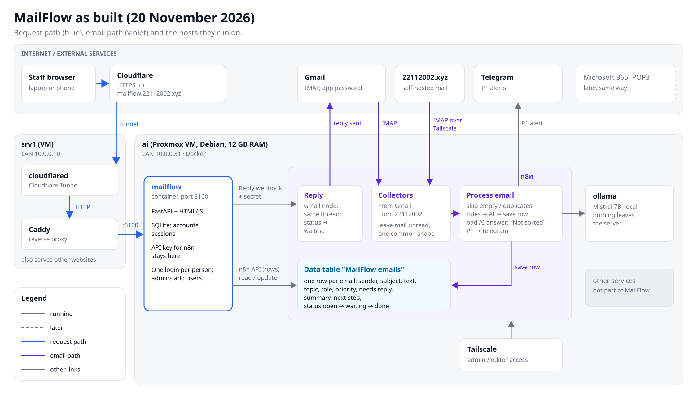
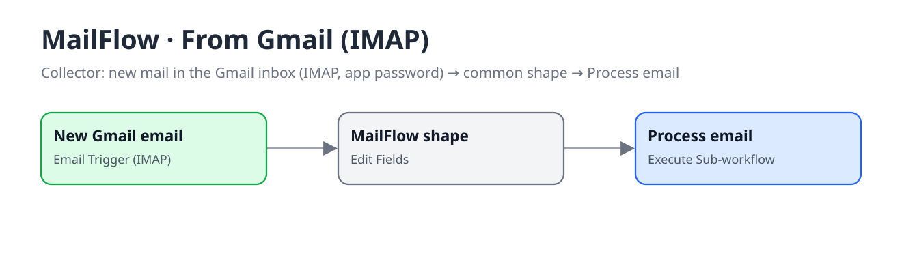
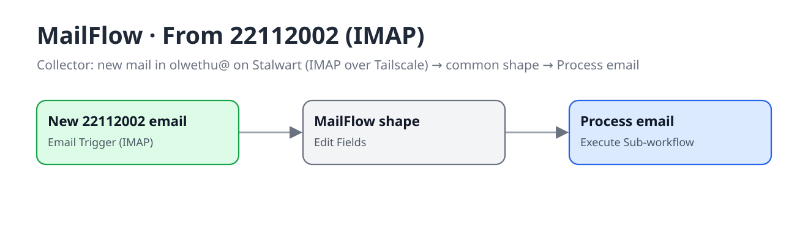
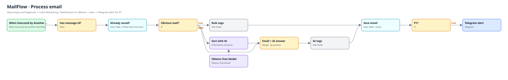
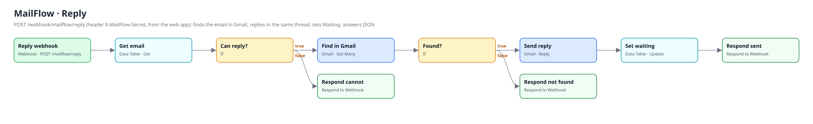
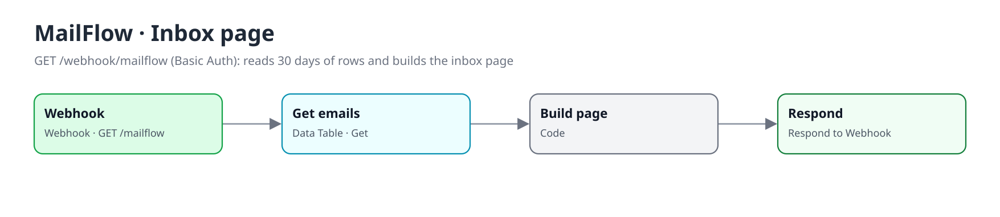
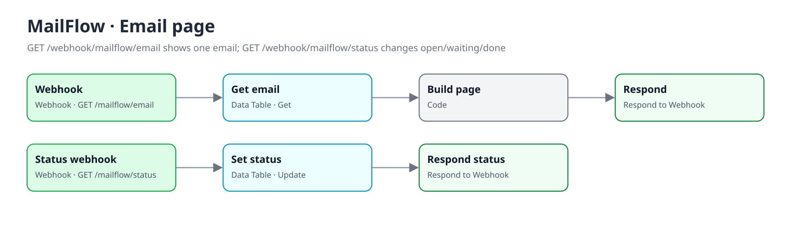

# MailFlow as built

What is actually running, as of **20 November 2026**: the n8n workflows on `ai` and, since 19
November, the MailFlow web app. The design ([SYSTEM-DESIGN.md](SYSTEM-DESIGN.md)) also covers the parts
still planned; this page shows only what exists.

The workflow pictures below are drawn from each workflow's n8n export with
[`tools/draw_workflows.py`](../tools/draw_workflows.py), so they show the real nodes and
connections. Colours: green = trigger, cyan = data table, purple = AI, amber = decision,
grey = transform, blue = sends something out, light green = web page answer. "true"/"false"
mark the two outputs of an If node; the dashed purple line is the AI model plugged into its node.

## Collectors

One per mailbox. Each turns the provider's email into the common shape and hands it to Process
email. Both read only mail from 16 November on and leave emails unread.

## Process email

Skips empty runs and emails already saved, sorts newsletters, no-reply and event-platform mail
(Devpost, Eventbrite, Luma, MLH) with rules, asks Mistral for the hackathon topic, priority, sender,
needs reply, summary and next step (design §2.3a), saves the row and sends a Telegram alert for
every P1. Lesson 2.

## The web app

`https://mailflow.22112002.xyz`, code in [`app/`](../app/). One container (`mailflow`) on `ai`,
published to the internet through srv1 (Cloudflare tunnel and Caddy), one login per person. It
reads and updates the `MailFlow emails` table through n8n's API and sends Gmail replies through
`MailFlow · Reply`. Run, deploy and account commands: [app/README.md](../app/README.md).

`MailFlow · Reply` takes the header `X-MailFlow-Secret` (credential `MailFlow app secret`) and
answers `{"result": "sent" | "cannot" | "not_found"}`.

## Error alerts (since 20 November)

`MailFlow · Errors` (Error Trigger → Telegram, credential `RI Email`) is the **Error workflow** of
every live MailFlow workflow: the two collectors, Process email and Reply. When one fails, Telegram
gets "⚠️ MailFlow error" with the workflow, the failing step, the error message and a link to the
execution in n8n. Tested by making a temporary workflow fail on purpose; the message arrived. An
AI answer that is merely unusable is not an error: that email is saved as *Not sorted* instead.

## Nightly cleanup (since 20 November)

`MailFlow · Cleanup` runs every night at 02:00 (cron `0 2 * * *`, n8n's time zone) and deletes
rows of `MailFlow emails` whose `received_at` is more than 90 days ago. The mailboxes are not
touched; only MailFlow's copies go. Its error workflow is `MailFlow · Errors`. Tested with a
temporary copy on a webhook: a 100-day-old test row was deleted, a 10-day-old one kept.

## The first pages (n8n, switched off after the app went live)

Kept in n8n, inactive, for rollback. They used the `MailFlow page login` (browser login pop-up).
Lessons 5 and 6.

## Where the workflows are kept

| What | Where |
|---|---|
| Running workflows | n8n on `ai` (`http://ai:5678` or `https://ai.tail653118.ts.net`), tag `mailflow` |
| Workflow files (backup, re-import) | Private repo `n8n-chatbot`, folder `mailflow/`, via its `tools/n8n-sync.py pull` |
| Pictures and docs | This repo |

To redraw the pictures after a change: export the workflows (`tools/n8n-sync.py pull` in the
private repo), then run `python3 tools/draw_workflows.py <that repo>/mailflow docs/images/workflows`
here.
