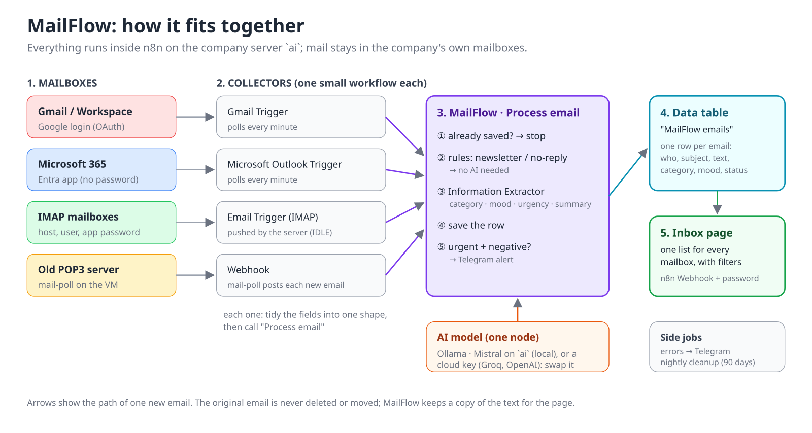
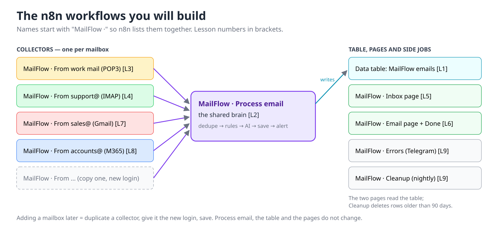
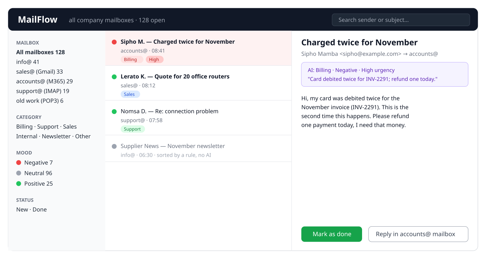
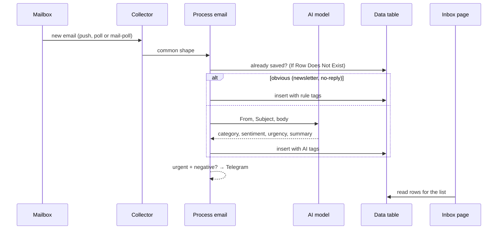
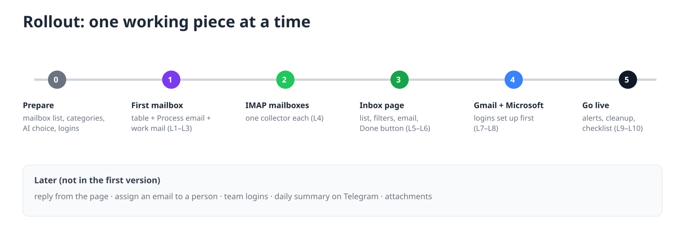

# MailFlow system design

MailFlow brings every company mailbox into one place, sorts each email by category and mood, and
shows them all on one web page. It is built entirely in **n8n** on the company's own server
(`ai`), with the AI running on that server too, so no email has to leave the company.

This repo is **public**. It holds the design, the lessons and the deck: never commit mailbox
addresses, passwords, API keys or email content here. Exported workflows go in the private
`n8n-chatbot` repo (section 10).



## 1. The problem and the goal

The company has many mailboxes on different providers (Gmail, Microsoft 365, IMAP hosting, an
old POP3 server). Nobody can see all incoming mail at once, so urgent or angry emails can sit
unnoticed in a mailbox nobody opened that day.

**First version (v1) does exactly this:**

1. Collect every new email from every connected mailbox, whatever the provider.
2. Give each one a **category** (Billing, Support, Sales, Internal, Newsletter, Other), a
   **sentiment** (Positive, Neutral, Negative), an **urgency** (High, Normal, Low) and a
   one-line **summary**.
3. Show all of them on **one web page**, newest first, with filters by mailbox, category, mood
   and status, and a **Done** button.
4. Send a **Telegram alert** for emails that are urgent and negative.

**Not in v1** (later, section 9): replying from the page, assigning emails to people, separate
logins per person, attachments, a daily summary.

**Unchanged by MailFlow:** the mailboxes themselves. Emails are not moved, deleted or marked
read; people keep using their normal mail apps. MailFlow keeps a copy of the text so the page
can show it.

## 2. The parts

| # | Part | What it is in n8n | Job |
|---|---|---|---|
| 1 | Mailboxes | (outside n8n) | Where mail arrives, as today |
| 2 | Collectors | One small workflow per mailbox | Notice new mail, put its fields into one common shape, hand it to Process email |
| 3 | Process email | One shared sub-workflow | Skip duplicates, sort obvious mail with rules, ask the AI about the rest, save, alert |
| 4 | Email table | An n8n **Data table** called `MailFlow emails` | One row per email |
| 5 | Pages | Two workflows that start with a **Webhook** | The inbox list and the single-email page, behind a password |
| — | AI model | One model node inside Process email | Ollama (Mistral, local) by default; a cloud model by swapping the node |
| — | Side jobs | Two small workflows | Error alerts to Telegram; nightly cleanup of rows older than 90 days |



### 2.1 Collectors: one per mailbox

| Mailbox type | n8n trigger node | Login | How new mail is noticed |
|---|---|---|---|
| Gmail / Google Workspace | **Gmail Trigger** (event: Message Received) | Google OAuth2 credential (a Google Cloud project, section 6) | Polls on a schedule, e.g. every minute; up to 50 emails per poll. Set **Read Status** to *Unread and read emails*: the default (unread only) misses mail someone opened in Gmail before the poll |
| Microsoft 365 / Outlook | **Microsoft Outlook Trigger** (Message Received) | **Microsoft Entra Service Principal (App-Only)** credential: an app in the company's Entra with mail permission, no user password | Polls on a schedule |
| Any IMAP mailbox | **Email Trigger (IMAP)** | IMAP credential: host, port, user, password or app password | The server pushes new mail (IMAP IDLE). It fetches unread mail, so an email read in a mail app while n8n was down is skipped |
| Old POP3 server | **Webhook** | `mail-poll` on the VM logs in; the webhook checks a secret header | `mail-poll` checks every minute and posts each new email |

Every collector ends the same way: an **Edit Fields** node turns that provider's fields into the
common shape below, then an **Execute Sub-workflow** node calls `MailFlow · Process email`.
Adding a mailbox later means duplicating a collector of the same type and choosing the new login.

**Why a separate POP3 path:** the old work server (IMail 8.22) has no IMAP IDLE, and n8n's IMAP
trigger never fired on it (tested 2026-10-15, DDOService build log). `mail-poll` reads it over
POP3 instead and already posts every new email to n8n.

### 2.2 The common shape (what every collector sends)

| Field | Example | Notes |
|---|---|---|
| `message_id` | `<abc123@mail.example.com>` | The email's own Message-ID header; used to skip duplicates. If a provider gives none, use the provider's message id |
| `mailbox` | `accounts@` | Which company mailbox it arrived in (a short label, your choice) |
| `source` | `gmail`, `outlook`, `imap`, `pop3` | |
| `from_name` | `Sipho Mamba` | |
| `from_address` | `sipho@example.com` | |
| `subject` | `Charged twice for November` | |
| `received_at` | `2026-11-16T08:41:00+02:00` | |
| `body` | plain text | First 4,000 characters; HTML is turned into text |

### 2.3 Process email (the shared brain)

Starts with **When Executed by Another Workflow** (input mode: *Define using fields below*, the
fields above). Then:

1. **Data Table → If Row Does Not Exist** (`message_id` equals the incoming `message_id`).
   Emails already saved stop here, so a collector that runs twice does no harm.
2. **If** node, "obvious mail" rules, no AI:
   - body contains `unsubscribe`, or sender contains `noreply`, `no-reply` or `newsletter`
     → category `Newsletter`, sentiment `Neutral`, urgency `Low`, summary = subject.
3. Everything else goes to **Information Extractor** with the AI model attached. It returns
   exactly four fields, using this JSON Schema (*Schema Type: Define using JSON Schema*):

   ```json
   {
     "type": "object",
     "properties": {
       "category":  { "type": "string", "enum": ["Billing","Support","Sales","Internal","Newsletter","Other"], "description": "What the email is about" },
       "sentiment": { "type": "string", "enum": ["Positive","Neutral","Negative"], "description": "The sender's mood" },
       "urgency":   { "type": "string", "enum": ["High","Normal","Low"], "description": "High if it needs an answer today" },
       "summary":   { "type": "string", "description": "One short sentence, at most 15 words" }
     },
     "required": ["category","sentiment","urgency","summary"]
   }
   ```

   Text sent to the model: `From: … / Subject: … / body`. Model temperature **0**, so the same
   email gets the same answer.
4. **Data Table → Insert** a row (section 4).
5. **If** `urgency = High` and `sentiment = Negative` → **Telegram** message to the owner with
   mailbox, sender, subject and summary.

The categories are a starting set; change the `enum` list (and the page's filter list) to the
company's own. Keep them few (5-8) and distinct: the model is more accurate with fewer, clearer
choices.

### 2.4 The pages

Both pages are n8n workflows that start with a **Webhook** node (method GET, authentication
**Basic Auth**) and end with **Respond to Webhook** returning HTML.

| Page | Path | Does |
|---|---|---|
| Inbox | `/webhook/mailflow` | Reads the newest 200 rows matching the filters in the address (`?mailbox=&category=&sentiment=&status=`), builds the list in a **Code** node |
| Email | `/webhook/mailflow/email?id=…` | Shows one email with its AI tags; **Mark as done** sets `status = done` and returns to the list |

The page looks like this (the first version may be plainer):



## 3. One email's journey



## 4. Data: the `MailFlow emails` table

An n8n **Data table** (Overview → Data tables). Column types are those n8n offers: string,
number, boolean, date.

| Column | Type | Filled by |
|---|---|---|
| `message_id` | string | collector |
| `mailbox` | string | collector |
| `source` | string | collector |
| `from_name` | string | collector |
| `from_address` | string | collector |
| `subject` | string | collector |
| `received_at` | date | collector |
| `body` | string | collector (max 4,000 characters) |
| `category` | string | rules or AI |
| `sentiment` | string | rules or AI |
| `urgency` | string | rules or AI |
| `summary` | string | rules or AI |
| `sorted_by` | string | `rule` or `ai` |
| `status` | string | `new` on insert; `done` from the page |

**Size.** n8n limits all data tables together to **200 MiB** by default
(`N8N_DATA_TABLES_MAX_SIZE_BYTES` changes it). At 100-1,000 emails a day and up to about 4.5 KB
a row, that is 0.5-4.5 MB a day [estimate], so the default fills in 6 weeks to a year. Plan:
keep 90 days (nightly cleanup) and raise the limit to 1 GiB on the server once volume is known.

**Backup.** Data tables live in n8n's own database, which the server's existing backup
(`automation-backup`) already covers.

## 5. The AI

| Choice | Speed per email | Cost | Where the email text goes |
|---|---|---|---|
| **Ollama · Mistral 7B on `ai`** (default) | **22-30 s** once loaded; **99 s** for the first email after the model unloaded (measured, below) | Nothing extra | Stays on the server |
| Cloud model with an API key (Groq, OpenAI, OpenRouter) | A few seconds | Fractions of a cent per email | To that provider |

Swapping is one node: delete the **Ollama Chat Model** under Information Extractor and attach
**Groq Chat Model** or **OpenAI Chat Model** with its credential. Nothing else changes.

**Measured on `ai`, 2026-11-16** (Information Extractor + Ollama Chat Model `mistral:latest`,
temperature 0, the schema above, four test emails sent to a temporary workflow, since deleted):

| Test email | Answer | Time |
|---|---|---|
| "Charged twice for November" (angry, wants refund today) | Billing · Negative · High · "Card debited twice for November invoice (INV-2291). Refund one payment today." | 99.1 s (model loading) |
| "Quote for 20 office routers" | Sales · Positive · High · "Quote for 20 office routers, installation, and 12-month support plan…" | 29.8 s |
| "November product newsletter" | Newsletter · Neutral · Normal · "New firmware, webinar dates, and holiday schedule…" | 24.5 s |
| "Re: connection problem" (thank-you) | Support · Positive · Normal · "Technician fixed connection problem, great service" | 21.6 s |

Category and mood were right on all four. In real use the newsletter would be caught by the
rules first and never reach the AI.

**Capacity.** Warm, Mistral sorts about 120-160 emails an hour. 1,000 emails a day is about 42
an hour on average, so it keeps up, but morning peaks queue for a while. Ollama answers one
request at a time and is shared with the other AI workflows on `ai`.

**Keep the model loaded.** The server unloads Mistral after 2 idle minutes
(`OLLAMA_KEEP_ALIVE=2m`), so a quiet gap costs the next email about 70 extra seconds. For
MailFlow, raise it to `30m` in `/opt/automation/.env`: Mistral then holds about 5 GB of the VM's
12 GB while mail keeps arriving (the VM uses about 2 GB without it).

## 6. Logins and setup per provider

| Provider | One-time setup | Who can do it |
|---|---|---|
| IMAP | Host, port (993), user and password per mailbox; an **app password** where the provider offers one | Whoever has the mailbox password |
| POP3 (old server) | Add the mailbox to `mail-poll` (server side, needs `sudo` on `ai`) | You, with me |
| Gmail / Workspace | A Google Cloud project: enable the **Gmail API**, OAuth consent screen (**Internal** if Workspace, so no Google review), a **Web application** OAuth client whose redirect URL is the one n8n shows in the credential | A Google Workspace admin, or the Gmail account owner |
| Microsoft 365 | An **app registration** in Microsoft Entra with the **Mail.Read** *application* permission and admin consent; in n8n the *Microsoft Entra Service Principal (App-Only)* credential with its tenant ID, client ID and secret | A Microsoft 365 / Entra admin |

**Two things to settle before the Gmail lesson:**

- Google only accepts an OAuth redirect address that is `https`, or `localhost`. n8n shows its
  redirect URL in the credential form; if it starts with `http://ai:5678`, Google will refuse
  it. Fix options (decide together at lesson 7): open n8n over Tailscale HTTPS for the sign-in,
  or let `n8n.22112002.xyz` pass n8n's OAuth callback path. [To verify at setup]
- The Entra app should be limited to the MailFlow mailboxes only (Exchange's application access
  rules), not every mailbox in the company. [To verify with the admin]

## 7. Security and privacy

| Risk | Control |
|---|---|
| The pages show company email | Webhook **Basic Auth** on both pages, a strong password; the address is only shared inside the company |
| n8n's webhooks are reachable from the internet through `https://n8n.22112002.xyz/webhook/…` (DDOService decision D16) | Recommended: add a rule on srv1's Caddy that blocks `/webhook/mailflow*` from the internet, so the pages work only on the tailnet (`http://ai:5678/webhook/mailflow`) |
| Mailbox passwords and keys | Only in n8n credentials (encrypted in n8n's database); never in workflows, exports or this repo |
| Email text sent to an AI | Default is local Ollama: nothing leaves the server. A cloud model needs the company's OK first |
| The POP3 webhook could be called by anyone | Header Auth credential (secret header), like `Work email webhook secret` today |
| Old data piling up | Nightly cleanup deletes rows older than 90 days |
| Mailboxes changed by MailFlow | Triggers read only. IMAP trigger action set to **None** (do not mark as read); Gmail and Outlook triggers only read |

## 8. Operations

| What | How |
|---|---|
| Errors | Every MailFlow workflow sets **Error workflow** = `MailFlow · Errors`, which sends the workflow name and error to Telegram (credential `RI Email`) |
| Cleanup | `MailFlow · Cleanup`: Schedule Trigger at 02:00 → Data Table **Delete** rows where `received_at` is before 90 days ago |
| Is it working? | The inbox page header shows the newest email's time; n8n → Executions lists failed runs (successful runs are not stored on this server) |
| Backup | Workflows and the table are in n8n's database, covered by the server backup; workflow exports also in the private repo |
| Adding a mailbox | Duplicate a collector of the same type, choose the new credential, change the `mailbox` label, activate |

## 9. Rollout



| Phase | What works at the end | Lessons |
|---|---|---|
| 0. Prepare | Mailbox list, categories, AI choice, logins collected ([WHAT-I-NEED.md](WHAT-I-NEED.md)) | 0 |
| 1. First mailbox | Work mail (POP3) sorted into the table | 1-3 |
| 2. IMAP mailboxes | Every IMAP mailbox sorted | 4 |
| 3. Inbox page | Everyone can see all mail on one page; Done button | 5-6 |
| 4. Gmail + Microsoft | All providers connected | 7-8 |
| 5. Go live | Error alerts, cleanup, checklist passed | 9-10 |
| Later | Reply from the page; assign to a person; per-person logins; daily summary; attachments | — |

## 10. Conventions

- **Names:** every workflow starts with `MailFlow · ` and carries the tag `mailflow`.
- **Exports:** workflows are exported to the private `n8n-chatbot` repo, folder `mailflow/`,
  with its `tools/n8n-sync.py` (add `"MailFlow": "mailflow"` to its project list). Exports name
  credentials only, never secrets.
- **This repo:** design, lessons, deck, pictures. No addresses, passwords or email content.

## 11. Decisions

| # | Decision | Over | Why |
|---|---|---|---|
| M1 | Build in **n8n** | A ready-made inbox app (Chatwoot, MailFlow.sh) or custom code | The owner wants to learn and own it in n8n; n8n has triggers for all four mailbox types and the AI nodes built in |
| M2 | **One shared Process email** sub-workflow | Sorting inside each collector | One place to change categories, rules and the AI; collectors stay tiny |
| M3 | **Data table** for storage | Postgres, Google Sheets | Already inside n8n, no new container, covered by the backup; enough for 90 days at this volume |
| M4 | **Information Extractor**, one AI call per email | Text Classifier + Sentiment Analysis nodes (two calls) | Half the AI time on a CPU-only model; one structured answer |
| M5 | **Rules before AI** | AI for everything | Newsletters and no-reply mail need no AI and would waste 25 s each |
| M6 | **Local Mistral** by default, cloud as a one-node swap | Cloud only | Email stays on the server; the swap is there if volume outgrows it |
| M7 | Pages as n8n **Webhook + HTML** | A separate web app | Stays in n8n; good enough for v1; a real app can read the same table later |
| M8 | POP3 through **mail-poll** | n8n IMAP trigger | The trigger never fired on the old server (2026-10-15) |

## 12. Risks

| Risk | Effect | What we do |
|---|---|---|
| Morning peak of mail with local Mistral | Emails wait in a queue before they appear | Rules first; `OLLAMA_KEEP_ALIVE=30m`; cloud model if it stays behind |
| Google redirect URL is `http://ai:5678` | Gmail login fails | Settle the HTTPS address before lesson 7 (section 6) |
| Entra app reads every company mailbox | Too much access | Restrict it to the MailFlow mailboxes with the admin |
| Data table fills up | Inserts fail, the error alert fires | 90-day cleanup; raise the limit to 1 GiB |
| A provider changes its login rules (e.g. Microsoft turns off password SMTP for existing tenants at the end of December 2026) | That collector stops | Microsoft uses the Entra app, not a password; errors go to Telegram |
| AI gets a category wrong | Email in the wrong filter | The page shows the email anyway; adjust category descriptions; a later version can let people correct it |
