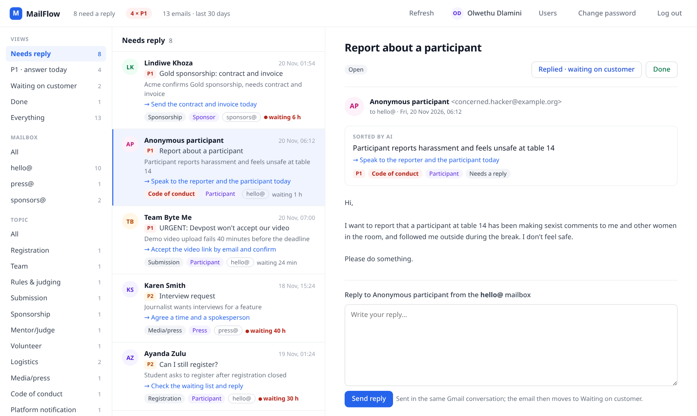
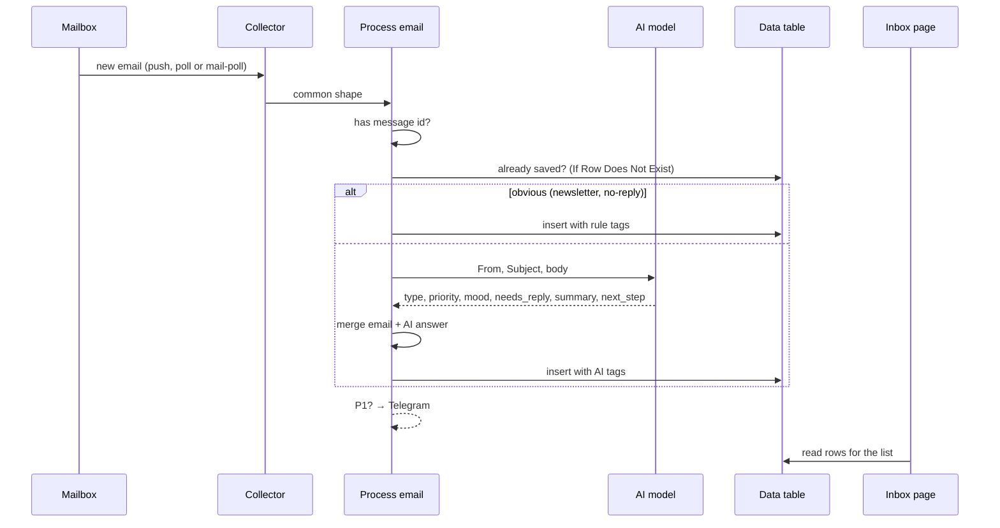

# MailFlow system design

MailFlow brings every mailbox into one place, sorts each email for the people who answer it
(what it is about, who sent it, how soon to answer, whether it needs a reply, what to do next), and
shows them all on one web page as a queue. Since 2026-11-19 the labels are for a **hackathon
organiser** (§2.3a, decision M12); they started as customer-service labels. It is built in **n8n** on the company's own server
(`ai`), with the AI running on that server too, so no email has to leave the company.

This repo is **public**. It holds the design, the lessons, the decks and the web app: never commit
mailbox addresses, passwords, API keys or email content here. Exported workflows go in the private
`n8n-chatbot` repo (section 10).


**The system today (20 November 2026), in one paragraph.** Mailboxes (Gmail and a self-hosted
IMAP server) are read by one n8n **collector** each; the shared **Process email** workflow skips
duplicates, sorts obvious mail by rules and the rest with **Mistral 7B** on `ai` (topic, sender,
priority, needs reply, summary, next step; an unusable answer is saved as *Not sorted*), stores one
row per email in an n8n **data table** and sends a Telegram alert for P1. The **MailFlow web app**
(FastAPI, one Docker container on `ai`, a login per person) shows the queue at
`https://mailflow.22112002.xyz`, reached through Cloudflare and Caddy on `srv1`; it reads and updates
the table through n8n's API and sends Gmail replies through the n8n **Reply** workflow. Where each
part runs: [AS-BUILT.md](AS-BUILT.md). Explained slide by slide:
[the technical deck](../deck/MailFlow-Technical.pdf); for clients: [the client deck](../deck/MailFlow-Client.pdf).

## 1. The problem and the goal

The company has many mailboxes on different providers (Gmail, Microsoft 365, IMAP hosting, an
old POP3 server). Nobody can see all incoming mail at once, so urgent or angry emails can sit
unnoticed in a mailbox nobody opened that day.

**First version (v1) does exactly this:**

1. Collect every new email from every connected mailbox, whatever the provider.
2. Give each one a **topic** (stored in the `type` column), a **priority** (**P1** answer today,
   **P2** this week, **P3** no rush or no answer), the **sender** (who is writing),
   **needs a reply** yes/no, a one-line **summary** and a **next step**. The hackathon topics
   and senders are in §2.3a; until 2026-11-19 these were customer-service types and a **mood**.
3. Show all of them on **one web page** as a work queue: by default what needs a reply, P1 first
   and oldest first, with views (Needs reply, P1, Waiting on customer, Done, Everything), filters
   by mailbox, topic and sender, and a "waiting X h" label that turns red when an email is late.
4. Track each email's **status**: `open` → `waiting` (replied, waiting on the customer) →
   `done`; **Reopen** sets it back to `open`.
5. Send a **Telegram alert** for every **P1** email.

**Not in v1** (later, section 9): replying from the page, assigning emails to people, separate
logins per person, attachments, a daily summary.

**Unchanged by MailFlow:** the mailboxes themselves. Emails are not moved, deleted or marked
read; people keep using their normal mail apps. MailFlow keeps a copy of the text so the page
can show it.

## 2. The parts

| # | Part | What it is in n8n | Job |
|---|---|---|---|
| 1 | Mailboxes | (outside n8n) | Where mail arrives, as today |
| 2 | Collectors | One small workflow per mailbox | Notice new mail, put its fields into one common shape, hand it to Process email |
| 3 | Process email | One shared sub-workflow | Skip duplicates, sort obvious mail with rules, ask the AI about the rest, save, alert |
| 4 | Email table | An n8n **Data table** called `MailFlow emails` | One row per email |
| 5 | Pages | Two workflows that start with a **Webhook** | The inbox list and the single-email page, behind a password |
| — | AI model | One model node inside Process email | Ollama (Mistral, local) by default; a cloud model by swapping the node |
| — | Side jobs | Two small workflows | Error alerts to Telegram; nightly cleanup of rows older than 90 days |


### 2.1 Collectors: one per mailbox

| Mailbox type | n8n trigger node | Login | How new mail is noticed |
|---|---|---|---|
| Gmail / Google Workspace | **Gmail Trigger** (event: Message Received) | Google OAuth2 credential (a Google Cloud project, section 6) | Polls on a schedule, e.g. every minute; up to 50 emails per poll. Set **Read Status** to *Unread and read emails*: the default (unread only) misses mail someone opened in Gmail before the poll |
| Microsoft 365 / Outlook | **Microsoft Outlook Trigger** (Message Received) | **Microsoft Entra Service Principal (App-Only)** credential: an app in the company's Entra with mail permission, no user password | Polls on a schedule |
| Any IMAP mailbox | **Email Trigger (IMAP)** | IMAP credential: host, port, user, password or app password | The server pushes new mail (IMAP IDLE). It fetches unread mail, so an email read in a mail app while n8n was down is skipped |
| Old POP3 server | **Webhook** | `mail-poll` on the VM logs in; the webhook checks a secret header | `mail-poll` checks every minute and posts each new email |

Every collector ends the same way: an **Edit Fields** node turns that provider's fields into the
common shape below, then an **Execute Sub-workflow** node calls `MailFlow · Process email`.
Adding a mailbox later means duplicating a collector of the same type and choosing the new login.

**Why a separate POP3 path:** the old work server (IMail 8.22) has no IMAP IDLE, and n8n's IMAP
trigger never fired on it (tested 2026-10-15, DDOService build log). `mail-poll` reads it over
POP3 instead and already posts every new email to n8n.

### 2.2 The common shape (what every collector sends)

| Field | Example | Notes |
|---|---|---|
| `message_id` | `<abc123@mail.example.com>` | The email's own Message-ID header; used to skip duplicates. If a provider gives none, use the provider's message id |
| `mailbox` | `accounts@` | Which company mailbox it arrived in (a short label, your choice) |
| `source` | `gmail`, `outlook`, `imap`, `pop3` | |
| `from_name` | `Sipho Mamba` | |
| `from_address` | `sipho@example.com` | |
| `subject` | `Charged twice for November` | |
| `received_at` | `2026-11-16T08:41:00+02:00` | |
| `body` | plain text | First 4,000 characters; HTML is turned into text |

### 2.3 Process email (the shared brain)

Starts with **When Executed by Another Workflow** (input mode: *Define using fields below*, the
fields above). Then:

1. **Filter** `Has message id?`: `message_id` is not empty. A test run with no email stops here
   instead of saving an empty row.
2. **Data Table → If Row Does Not Exist** `Already saved?` (`message_id` equals the incoming
   `message_id`). Emails already saved stop here, so a collector that runs twice does no harm.
3. **If** `Obvious mail?`, rules, no AI (any one is enough): body contains `unsubscribe`, or
   sender contains `noreply`, `no-reply` or `newsletter`.
   - **true** → **Edit Fields** `Rule tags`: type `Notification` if the sender matches
     `/no-?reply/i`, else `Marketing`; priority `P3`; mood `Neutral`; needs_reply `false`;
     summary = subject; next_step `No reply needed`; sorted_by `rule`; status `open`.
   - **false** → **Information Extractor** `Sort with AI` with the **Ollama Chat Model**
     (`mistral:latest`, temperature **0**, so the same email gets the same answer) attached.
     Text sent to the model: `From: … / Subject: … / body`. It returns exactly six fields, using
     this JSON Schema (*Schema Type: Define using JSON Schema*):

   ```json
   {
     "type": "object",
     "properties": {
       "type": {"type": "string", "enum": ["Complaint", "Question", "Request", "Order", "Payment", "Technical", "Cancellation", "Feedback", "Marketing", "Notification", "Other"], "description": "What the sender wants. Complaint: unhappy about something that went wrong. Question: asks for information. Request: asks us to do or change something. Order: wants to buy or asks for a quote. Payment: invoices, charges, refunds. Technical: something does not work. Cancellation: wants to stop a service. Feedback: praise or suggestions. Marketing: newsletters and promotions. Notification: automatic messages from systems. Other: anything else."},
       "priority": {"type": "string", "enum": ["P1", "P2", "P3"], "description": "P1: answer today (angry customer, service down, money taken wrongly, threat to cancel or leave, legal). P2: answer this week (normal customer questions, requests, orders). P3: no rush or no answer needed (thanks, newsletters, notifications)."},
       "mood": {"type": "string", "enum": ["Angry", "Frustrated", "Neutral", "Happy"], "description": "The sender's mood"},
       "needs_reply": {"type": "boolean", "description": "true if a person must answer this email, false for automatic messages, newsletters and simple thank-yous"},
       "summary": {"type": "string", "description": "What the email says, one short sentence, at most 15 words"},
       "next_step": {"type": "string", "description": "What our staff should do next, at most 12 words, starting with a verb"}
     },
     "required": ["type", "priority", "mood", "needs_reply", "summary", "next_step"]
   }
   ```

   The AI node outputs only its answer (`output`), so a **Merge** `Email + AI answer` (Combine,
   by Position) joins the email (input 1, a second line from the false branch) with its answer
   (input 2). **Edit Fields** `AI tags` then takes the email fields from `$json` and the AI
   fields from `$json.output.*` (`needs_reply` as a Boolean), with sorted_by `ai`, status `open`.
4. **Data Table → Insert** `Save email`, *Map Automatically* (field names equal column names,
   section 4).
5. **If** `P1?` (`priority` equals `P1`) → **Telegram** `Telegram alert` to the owner:

   ```
   🔴 P1 email: answer today
   Mailbox: … · type · mood
   From: name <address>
   Subject: …
   summary
   Next: next step
   ```

The schema above is the **first, customer-service version** (2026-11-16). It was replaced on
2026-11-19 by the hackathon scheme in §2.3a; the steps around it are unchanged.

### 2.3a The hackathon scheme (since 2026-11-19, decision M12)

| Field | Values |
|---|---|
| `type` = **topic** | Registration · Team · Rules & judging · Submission · Sponsorship · Mentor/Judge · Volunteer · Logistics (venue, power, WiFi, travel, food, visa letters, accessibility) · Prizes & payouts · Media/press · Withdrawal · Code of conduct · Platform notification · Marketing · Other |
| `sender` | Participant · Sponsor · Mentor/Judge · Volunteer · Vendor/Venue · Press · Organiser · Automated · Other |
| `priority` | **P1** today: code of conduct or safety, a problem during the event, a submission problem near the deadline, sponsor commitments, payments or prize money. **P2** this week: normal questions, registrations, teams, logistics, mentors, volunteers, press. **P3**: no answer needed |
| `needs_reply`, `summary`, `next_step` | as before |

**Where it lives.** The topic, sender and priority rules are in the `Sort with AI` node's
**System Prompt Template** (*Options*), one line per topic, ending with the exact form of the
answer. The JSON Schema keeps the six fields and the allowed values (`enum`); its descriptions
point to the instructions. Mistral 7B ignored a single long description inside the schema (it
put 10 of 15 test emails under the first topic, Registration), and without the answer form at
the end it answered with a copy of the schema ("Model output doesn't fit required format").

**Rules before the AI.** `Obvious mail?` also catches senders containing `devpost.com`,
`eventbrite.`, `luma` or `mlh.io`. `Rule tags` sets topic *Platform notification* (event
platforms and no-reply senders) or *Marketing* (newsletters), sender *Automated*, P3.

**Measured on `ai`, 2026-11-19** (`mistral:latest`, temperature 0, sent through `MailFlow ·
Process email` one at a time): 16 made-up hackathon emails, one or more per topic and sender.

| Instructions | Topic right | Sender right | Priority right | Time per email |
|---|---|---|---|---|
| Long description inside the schema | 4 of 15 (10 said *Registration*) | 14 of 15 | 13 of 15 | ~32 s |
| System prompt, one line per topic, answer form | 15 of 16, then 16 of 16 after separating *Sponsorship* (gives) from *Marketing* (sells) | 16 of 16 | 15 of 16 | ~30 s (one email 100 s) |

The one priority miss: a withdrawal for a family emergency came out P1 where P2 was expected. The
Devpost notification was caught by the rules in 6 s. A run with several emails at once saved one
email twice and lost another, because `Already saved?` and the insert are not one step; collectors
send one email at a time, so this does not happen in normal use.

**No email is lost when the AI's answer is unusable.** Mistral sometimes breaks the form (in the
re-sort it put a sender, "Vendor/Venue", into the topic), and n8n then rejects the answer. Until
2026-11-19 that stopped the run and the email was never saved. Now `Sort with AI` has *On Error:
Continue*, and `AI tags` falls back to topic *Other*, sender *Other*, P2, needs a reply, next step
"Sort this email by hand", `sorted_by` = `unsorted`; the page says "Not sorted" on such emails.
Tested by feeding that same email again: saved as unsorted, and a normal email still sorted.

**The page** ([`app/`](../app/)) filters by Topic and Sender; `TOPICS` and `SENDERS` in
`app/src/mailflow/queue.py` must equal the `enum` lists. *Code of conduct* is shown in red.
The Telegram P1 alert names the topic and the sender.

### 2.4 The pages

**Since 2026-11-19 the page is the MailFlow web app** ([`app/`](../app/), decision M11) at
`https://mailflow.22112002.xyz`: one account per person, the same views, filters, sorting, late
rule, status buttons and Gmail reply as below, in three panes (views and filters, the queue, the
open email). It reads and updates the data table through n8n's API and calls `MailFlow · Reply`
with a secret header. The n8n page workflows below were the first version; they were switched off
on 2026-11-19 when the app went live, and are kept in n8n for rollback.

The first version: both pages are n8n workflows that start with a **Webhook** node (method GET,
authentication **Basic Auth**) and end with **Respond to Webhook** returning HTML.

| Page | Path | Does |
|---|---|---|
| Inbox | `/webhook/mailflow` | Reads up to 300 rows of the last 30 days (newest first), then a **Code** node applies the view and filters in the address (`?view=&mailbox=&type=&mood=`) and builds the list |
| Email | `/webhook/mailflow/email?id=…` | Shows one email with its AI box (priority, type, mood, needs a reply, summary, next step), the body and status buttons |
| Status | `/webhook/mailflow/status?id=…&to=…` | Second trigger in the Email page workflow: sets `status` to `open`, `waiting` or `done` (anything else becomes `open`) and returns to the list |

**Inbox views** (left column, with counts): **Needs reply** (default: needs a reply and `open`),
**P1 · answer today** (P1, not done), **Waiting on customer**, **Done**, **Everything**. Below
them, filters by **Mailbox**, **Type** and **Mood** with counts. Queue views are sorted P1 → P3,
then oldest first; Done and Everything newest first. Each row shows the priority badge, type,
mood and mailbox chips, subject, summary, `→ next step` and **waiting X h**, which turns red after
4 h for P1 and 24 h for P2.

**Email page buttons:** open → **Replied · waiting on customer** and **Done**; waiting → **Done**
and **Reopen**; done → **Reopen**. Replies are still written in the normal mail app.

The page as it is now (the MailFlow web app, made-up example emails from `deck/demo_server.py`);
the n8n first version used the [mock-up](images/inbox-mockup.png) as its target:



**Replying from the page (2026-11-16).** Emails in the `gmail` mailbox get a reply box. It posts
to `MailFlow · Reply` (`/webhook/mailflow/reply`; since 2026-11-19 Header Auth `X-MailFlow-Secret`,
credential `MailFlow app secret`, answering JSON `{"result": "sent" | "cannot" | "not_found"}`),
which finds the email in Gmail by its Message-ID (`rfc822msgid:` search), sends the reply with the
**Gmail** node's *Reply* operation so it threads and lands in Sent, and sets `status = waiting`. It uses the Gmail
OAuth2 credential, which needed n8n on https (`N8N_EDITOR_BASE_URL`, Tailscale Serve on `ai`).
Other mailboxes still say "reply in your mail app": n8n's Send Email node cannot set
`In-Reply-To`, so those need their own threaded sender (e.g. the DDOService bridge) later.

## 3. One email's journey



## 4. Data: the `MailFlow emails` table

An n8n **Data table** (Overview → Data tables). Column types are those n8n offers: string,
number, boolean, date.

| Column | Type | Filled by |
|---|---|---|
| `message_id` | string | collector |
| `mailbox` | string | collector |
| `source` | string | collector |
| `from_name` | string | collector |
| `from_address` | string | collector |
| `subject` | string | collector |
| `received_at` | date | collector |
| `body` | string | collector (max 4,000 characters) |
| `type` | string | rules or AI: the hackathon **topic** (§2.3a); older rows hold customer-service types |
| `priority` | string | rules or AI (`P1`, `P2`, `P3`) |
| `sender` | string | rules or AI (since 2026-11-19): Participant, Sponsor, Mentor/Judge, Volunteer, Vendor/Venue, Press, Organiser, Automated, Other |
| `mood` | string | until 2026-11-19 only (customer-service scheme); no longer filled |
| `needs_reply` | boolean | rules or AI |
| `summary` | string | rules or AI |
| `next_step` | string | rules or AI |
| `sorted_by` | string | `rule` or `ai` |
| `status` | string | `open` on insert; `waiting` / `done` / `open` from the email page (older rows may still say `new`, read as `open`) |

**Size.** n8n limits all data tables together to **200 MiB** by default
(`N8N_DATA_TABLES_MAX_SIZE_BYTES` changes it). At 100-1,000 emails a day and up to about 4.5 KB
a row, that is 0.5-4.5 MB a day [estimate], so the default fills in 6 weeks to a year. Plan:
keep 90 days (nightly cleanup) and raise the limit to 1 GiB on the server once volume is known.

**Backup.** Data tables live in n8n's own database, which the server's existing backup
(`automation-backup`) already covers.

## 5. The AI

| Choice | Speed per email | Cost | Where the email text goes |
|---|---|---|---|
| **Ollama · Mistral 7B on `ai`** (default) | **40-60 s** once loaded with the current 6-field schema (22-30 s with the earlier 4-field one); the first email after the model unloaded takes longer (measured, below) | Nothing extra | Stays on the server |
| Cloud model with an API key (Groq, OpenAI, OpenRouter) | A few seconds | Fractions of a cent per email | To that provider |

Swapping is one node: delete the **Ollama Chat Model** under Information Extractor and attach
**Groq Chat Model** or **OpenAI Chat Model** with its credential. Nothing else changes.

**Measured on `ai`, 2026-11-16, earlier 4-field schema** (category, sentiment, urgency,
summary; replaced the same day by the schema in §2.3). Information Extractor + Ollama Chat Model
`mistral:latest`, temperature 0, four test emails sent to a temporary workflow, since deleted:

| Test email | Answer | Time |
|---|---|---|
| "Charged twice for November" (angry, wants refund today) | Billing · Negative · High · "Card debited twice for November invoice (INV-2291). Refund one payment today." | 99.1 s (model loading) |
| "Quote for 20 office routers" | Sales · Positive · High · "Quote for 20 office routers, installation, and 12-month support plan…" | 29.8 s |
| "November product newsletter" | Newsletter · Neutral · Normal · "New firmware, webinar dates, and holiday schedule…" | 24.5 s |
| "Re: connection problem" (thank-you) | Support · Positive · Normal · "Technician fixed connection problem, great service" | 21.6 s |

Category and mood were right on all four. In real use the newsletter would be caught by the
rules first and never reach the AI.

**Measured on `ai`, 2026-11-16, current schema** (§2.3, same model and settings, sent through
`MailFlow · Process email`):

| Test email | Answer | Next step |
|---|---|---|
| "Charged twice for November" | P1 · Complaint · Angry | "Refund one payment today" |
| "Quote for 20 office routers" | P2 · Order · Neutral | "Send pricing and lead time" |
| "Internet down since yesterday" | P1 · Complaint · Angry | "Investigate and fix internet issue" |
| "Cancel my subscription" | P2 · Cancellation · Neutral | "Cancel subscription at end of month" |

The four took **226 s** in one batch, including loading the model: about **40-60 s** each once
warm. The longer answer (six fields, two sentences) costs the extra time over the 4-field schema.
Mail sorted by the rules takes under a second.

**Capacity.** Warm, Mistral sorts about 60-90 emails an hour with the current schema. 1,000
emails a day is about 42 an hour on average, so it keeps up, but morning peaks queue for a while
(less where rules catch newsletters and notifications). Ollama answers one
request at a time and is shared with the other AI workflows on `ai`.

**Keep the model loaded.** The server unloads Mistral after 2 idle minutes
(`OLLAMA_KEEP_ALIVE=2m`), so a quiet gap costs the next email about 70 extra seconds. For
MailFlow, raise it to `30m` in `/opt/automation/.env`: Mistral then holds about 5 GB of the VM's
12 GB while mail keeps arriving (the VM uses about 2 GB without it).

## 6. Logins and setup per provider

| Provider | One-time setup | Who can do it |
|---|---|---|
| IMAP | Host, port (993), user and password per mailbox; an **app password** where the provider offers one | Whoever has the mailbox password |
| POP3 (old server) | Add the mailbox to `mail-poll` (server side, needs `sudo` on `ai`) | You, with me |
| Gmail / Workspace | A Google Cloud project: enable the **Gmail API**, OAuth consent screen (**Internal** if Workspace, so no Google review), a **Web application** OAuth client whose redirect URL is the one n8n shows in the credential | A Google Workspace admin, or the Gmail account owner |
| Microsoft 365 | An **app registration** in Microsoft Entra with the **Mail.Read** *application* permission and admin consent; in n8n the *Microsoft Entra Service Principal (App-Only)* credential with its tenant ID, client ID and secret | A Microsoft 365 / Entra admin |

**Two things to settle before the Gmail lesson:**

- Google only accepts an OAuth redirect address that is `https`, or `localhost`. n8n shows its
  redirect URL in the credential form; if it starts with `http://ai:5678`, Google will refuse
  it. Fix options (decide together at lesson 7): open n8n over Tailscale HTTPS for the sign-in,
  or let `n8n.22112002.xyz` pass n8n's OAuth callback path. [To verify at setup]
- The Entra app should be limited to the MailFlow mailboxes only (Exchange's application access
  rules), not every mailbox in the company. [To verify with the admin]

## 7. Security and privacy

| Risk | Control |
|---|---|
| The page shows company email, on the internet | The web app (M11): one account per person, scrypt passwords of 12+ characters; 5 failed logins lock an email and 20 lock a visitor's address for 15 min; HttpOnly, Secure, SameSite=Strict session cookie (12 h idle, 7 days); changes need the page's own header and origin; strict Content Security Policy; email text shown only as text. Reached only through Cloudflare and srv1 (the port is bound to ai's LAN address) |
| n8n's webhooks are reachable from the internet through `https://n8n.22112002.xyz/webhook/…` (DDOService decision D16) | `MailFlow · Reply` needs the `X-MailFlow-Secret` header (403 without it); the old page webhooks are switched off. The n8n API key the app uses stays on the server |
| Mailbox passwords and keys | Only in n8n credentials (encrypted in n8n's database); never in workflows, exports or this repo |
| Email text sent to an AI | Default is local Ollama: nothing leaves the server. A cloud model needs the company's OK first |
| The POP3 webhook could be called by anyone | Header Auth credential (secret header), like `Work email webhook secret` today |
| Old data piling up | Nightly cleanup deletes rows older than 90 days |
| Mailboxes changed by MailFlow | Triggers read only. IMAP trigger action set to **None** (do not mark as read); Gmail and Outlook triggers only read |

## 8. Operations

| What | How |
|---|---|
| Errors | Every MailFlow workflow sets **Error workflow** = `MailFlow · Errors`, which sends the workflow name and error to Telegram (credential `RI Email`) |
| Cleanup | `MailFlow · Cleanup`: Schedule Trigger at 02:00 → Data Table **Delete** rows where `received_at` is before 90 days ago |
| Is it working? | The inbox page's **Everything** view lists the newest email first; n8n → Executions lists failed runs (successful runs are not stored on this server) |
| Backup | Workflows and the table are in n8n's database, covered by the server backup; workflow exports also in the private repo |
| Adding a mailbox | Duplicate a collector of the same type, choose the new credential, change the `mailbox` label, activate |

## 9. Rollout


| Phase | What works at the end | Lessons |
|---|---|---|
| 0. Prepare | Mailbox list, email types and priorities, AI choice, logins collected ([WHAT-I-NEED.md](WHAT-I-NEED.md)) | 0 |
| 1. First mailbox | Work mail (POP3) sorted into the table | 1-3 |
| 2. IMAP mailboxes | Every IMAP mailbox sorted | 4 |
| 3. Inbox page | Everyone can see what needs a reply on one page, P1 first; status buttons | 5-6 |
| 4. Gmail + Microsoft | All providers connected | 7-8 |
| 5. Go live | Error alerts, cleanup, checklist passed | 9-10 |
| Later | Assign to a person; who-did-what log; replies from mailboxes other than Gmail; daily summary; attachments. Done 2026-11-16/19: reply from the page (Gmail), per-person logins (web app) | — |

## 10. Conventions

- **Names:** every workflow starts with `MailFlow · ` and carries the tag `mailflow`.
- **Exports:** workflows are exported to the private `n8n-chatbot` repo, folder `mailflow/`,
  with its `tools/n8n-sync.py` (add `"MailFlow": "mailflow"` to its project list). Exports name
  credentials only, never secrets.
- **This repo:** design, lessons, deck, pictures and the web app. No addresses, passwords, `.env` files or email content.

## 11. Decisions

| # | Decision | Over | Why |
|---|---|---|---|
| M1 | Build in **n8n** | A ready-made inbox app (Chatwoot, MailFlow.sh) or custom code | The owner wants to learn and own it in n8n; n8n has triggers for all four mailbox types and the AI nodes built in |
| M2 | **One shared Process email** sub-workflow | Sorting inside each collector | One place to change types, rules and the AI; collectors stay tiny |
| M3 | **Data table** for storage | Postgres, Google Sheets | Already inside n8n, no new container, covered by the backup; enough for 90 days at this volume |
| M4 | **Information Extractor**, one AI call per email | Text Classifier + Sentiment Analysis nodes (two calls) | Half the AI time on a CPU-only model; one structured answer |
| M5 | **Rules before AI** | AI for everything | Newsletters and no-reply mail need no AI and would waste 25 s each |
| M6 | **Local Mistral** by default, cloud as a one-node swap | Cloud only | Email stays on the server; the swap is there if volume outgrows it |
| M7 | Pages as n8n **Webhook + HTML** | A separate web app | Stays in n8n; good enough for v1; a real app can read the same table later |
| M8 | POP3 through **mail-poll** | n8n IMAP trigger | The trigger never fired on the old server (2026-10-15) |
| M9 | **Customer-service fields** (type, P1-P3 priority, mood, needs a reply, next step) and statuses open → waiting → done (2026-11-16) | Category + sentiment + urgency (Positive/Negative sorting) | Tells staff what to do and what to answer first, instead of only describing the email; one shared queue for now (per-person assignment later, §9) |
| M10 | Replies from the page through the **Gmail node** (Gmail mailbox only, 2026-11-16) | n8n Send Email node; extending the DDOService bridge | The owner's choice for now; the Gmail node threads replies and files them in Sent, Send Email cannot set `In-Reply-To`. Costs a Google Cloud project and n8n on https |
| M11 | The page as a **separate web app** (FastAPI, plain HTML/JS, one container on `ai`) at `mailflow.22112002.xyz`, **one account per person** (2026-11-19) | Keep n8n Webhook + HTML pages with Basic Auth (M7); a shared login; Google sign-in; Tailscale identity | The owner wants a real site, public on the company domain, with n8n as the engine. Per-person accounts allow "who did what" and assignment later. FastAPI like ollagi, ~60 MB of the VM's memory; n8n keeps every mailbox login and the AI |
| M12 | **Hackathon-organiser labels** (2026-11-19): topic (15 hackathon topics), sender (who is writing) instead of mood, P1-P3 rules for an event; replaced everywhere, old rows re-sorted | Keep customer service; per-mailbox schemes; mood and sender both | The owner's use case is a hackathon organiser: who is writing and what about decides the answer, mood did not. Sender keeps the AI at six fields, so the speed stays the same. Platform mail (Devpost, Eventbrite, Luma, MLH) is caught by rules |

## 12. Risks

| Risk | Effect | What we do |
|---|---|---|
| Morning peak of mail with local Mistral | Emails wait in a queue before they appear | Rules first; `OLLAMA_KEEP_ALIVE=30m`; cloud model if it stays behind |
| Google redirect URL is `http://ai:5678` | Gmail login fails | Settle the HTTPS address before lesson 7 (section 6) |
| Entra app reads every company mailbox | Too much access | Restrict it to the MailFlow mailboxes with the admin |
| Data table fills up | Inserts fail, the error alert fires | 90-day cleanup; raise the limit to 1 GiB |
| A provider changes its login rules (e.g. Microsoft turns off password SMTP for existing tenants at the end of December 2026) | That collector stops | Microsoft uses the Entra app, not a password; errors go to Telegram |
| AI gets a type or priority wrong | Email in the wrong filter, or a P1 not alerted / a P3 shown too high | The page shows the email anyway (Everything view); adjust the type and priority descriptions in the schema; a later version can let people correct it |
| Slower AI with the 6-field schema (40-60 s an email) | Longer queues at morning peaks | Same as the Mistral peak row; drop `next_step` or move to a cloud model if it stays behind |
