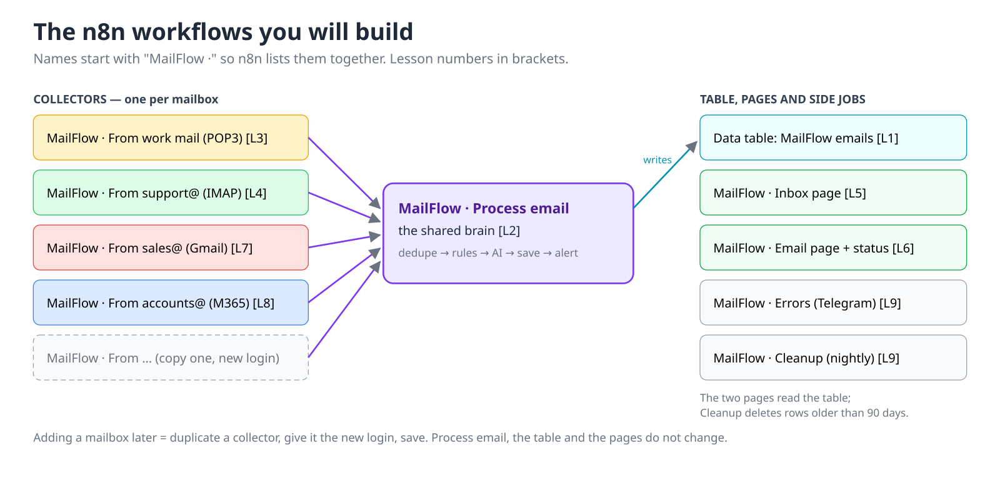

# MailFlow lessons

These lessons walk you through building MailFlow in n8n, one piece at a time. The design behind
them is in [SYSTEM-DESIGN.md](../SYSTEM-DESIGN.md). The decisions and logins you need are in
[WHAT-I-NEED.md](../WHAT-I-NEED.md).

## The lessons

| # | Lesson | What works at the end | Time |
|---|---|---|---|
| 0 | [n8n basics](00-n8n-basics.md) | You can run a workflow, read its output, write an expression and pin data | 20 min |
| 1 | [The email table](01-the-email-table.md) | The `MailFlow emails` data table exists with its 16 columns | 20 min |
| 2 | [Process email](02-process-email.md) | `MailFlow · Process email` sorts a test email and saves it | 1 h 30 |
| 3 | [First mailbox: work mail](03-first-mailbox-work-mail.md) | Real work mail lands in the table within about 2 minutes | 45 min |
| 4 | [IMAP mailboxes](04-imap-mailboxes.md) | Every IMAP mailbox is sorted into the table | 30 min, then 5 min per mailbox |
| 5 | [The inbox page](05-inbox-page.md) | One password-protected page lists what needs a reply, P1 first, with views and filters | 1 h 15 |
| 6 | [The email page](06-email-page.md) | Click an email to read it; **Replied · waiting on customer**, **Done** and **Reopen** work | 45 min |
| 7 | [Gmail](07-gmail.md) | Gmail / Google Workspace mailboxes are sorted | 1-2 h (mostly setup) |
| 8 | [Microsoft 365](08-microsoft-365.md) | Microsoft 365 mailboxes are sorted | 1-2 h (mostly waiting on the admin) |
| 9 | [Errors and cleanup](09-errors-and-cleanup.md) | Failures reach Telegram; rows older than 90 days are removed nightly | 45 min |
| 10 | [Go-live checklist](10-go-live-checklist.md) | Everything checked; MailFlow is live | 1 h |

Times are for a first time through.

## How to use them

1. Do **one lesson at a time**, in order. Each lesson builds on the one before.
2. Every lesson ends with **Check it works**. Do not start the next lesson until that check
   passes. If it fails, use the **If something goes wrong** table, or ask.
3. Use the exact node names and settings in **bold**. n8n shows the same words on screen.
4. Some field names are marked *not verified*. For those, do not type the name: open the node's
   input panel and **drag** the field into the box. n8n then writes the correct expression.
5. Never paste real mailbox addresses, passwords or chat IDs into this repo. They belong in n8n
   credentials and nodes only.

Every lesson has the same parts: Goal, What you need, Steps, Check it works, If something goes
wrong, What you learned.

## n8n words you will meet

| Word | What it means |
|---|---|
| **Node** | One box on the canvas. It does one job: read mail, change fields, call the AI, save a row. |
| **Trigger** | The first node of a workflow. It decides when the workflow starts (new email, a web request, a timer). |
| **Item** | One piece of data moving between nodes. One email = one item. A node runs once for every item it gets. |
| **Expression** | A small formula in `{{ }}` that reads data, e.g. `{{ $json.subject }}`. Fields switch to expressions when you drag data in or type `{{`. |
| **Credential** | A saved login (password, key, token). Nodes use it by name; the secret stays encrypted inside n8n. |
| **Execution** | One run of a workflow. Failed runs are listed under **Executions**. On this server, successful live runs are not saved. |
| **Sub-workflow** | A workflow that another workflow calls, like a function. `MailFlow · Process email` is one. |
| **Pin data** | Freezing a node's output so later test runs reuse it instead of fetching new data. Handy for testing without sending real mail. |
| **Test URL vs Production URL** | Every Webhook has two addresses. The **Test URL** works only while you click "Listen for test event" in the editor and shows the run on the canvas. The **Production URL** works only when the workflow is **active**. |
